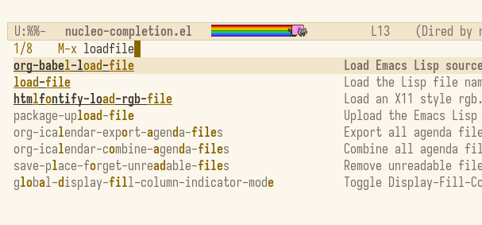
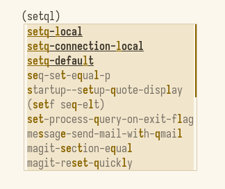

#+title: nucleo-completion

~nucleo-completion~ is an Emacs completion style backed by a Rust dynamic
module using the ~nucleo-matcher~ crate.  Emacs 29.1 or newer is required.

It also works without the Rust module by falling back to a simple Emacs Lisp
subsequence matcher.

* Screenshots
:PROPERTIES:
:ID:       d19e9b9a-6320-4076-a611-8e7dd6fd12bb
:END:

#+DOWNLOADED: screenshot @ 2026-04-26 08:10:52

#+DOWNLOADED: screenshot @ 2026-04-26 08:12:54

* Setup

Install from MELPA:

#+begin_src text
  M-x package-install RET nucleo-completion RET
#+end_src

On Emacs 29 or newer, you can also install directly from the repository with
~package-vc~:

#+begin_src emacs-lisp
  (package-vc-install
   '(nucleo-completion
     :url "https://github.com/kn66/nucleo-completion.el"))
#+end_src

Then enable the completion style:

#+begin_src emacs-lisp
  (require 'nucleo-completion)
  (add-to-list 'completion-styles 'nucleo)
#+end_src

Or configure it with ~use-package~ after installing it:

#+begin_src emacs-lisp
  (use-package nucleo-completion
    :config
    ;; Optional: install and load the Rust module when it is missing.
    (nucleo-completion-ensure-module)

    (setq completion-styles '(nucleo basic))
    (add-to-list 'completion-category-overrides
                 '(eglot-capf (styles nucleo basic)))

    (setq nucleo-completion-sort-ties-by-length t
          nucleo-completion-sort-ties-alphabetically t
          nucleo-completion-sort-ties-by-history t
          nucleo-completion-highlight-score-bands t))
#+end_src

The package works without a Rust dynamic module by using a simple Emacs Lisp
fallback matcher.  The fallback filters candidates and applies configured tie
sorting across all fallback matches, but it does not apply Rust-backed scoring.

To use a local checkout, add the package directory to ~load-path~:

#+begin_src emacs-lisp
  (add-to-list 'load-path "/path/to/nucleo-completion.el")
  (require 'nucleo-completion)
  (add-to-list 'completion-styles 'nucleo)
#+end_src

* Rust Dynamic Module

The Rust module is optional.  It enables Nucleo scoring and score-aware
highlighting; without it, candidates are filtered and tie-sorted by the Emacs
Lisp fallback.

The MELPA package does not include prebuilt binary modules.  To install a
module for the current platform from GitHub Releases, run:

#+begin_src text
  M-x nucleo-completion-install-module
#+end_src

The command asks before downloading, verifies the published SHA256 checksum,
stores the file under
~nucleo-completion-module-directory/<release-tag>/<target-triple>/~, and tries
to load it.  No download happens during package installation or ordinary
package load.  If a module was already loaded in the current Emacs process,
restart Emacs to use the newly installed file.

To opt in to automatic install from your configuration, call:

#+begin_src emacs-lisp
  (nucleo-completion-ensure-module)
#+end_src

This first tries to load an already installed module for the package-matched
release.  If no module is available, or only an older installed module could be
loaded, it downloads and installs the prebuilt module for the current platform.
Lisp calls install without asking;
~M-x nucleo-completion-ensure-module~ asks before downloading.

By default, the installer uses the GitHub Release tag matching
~nucleo-completion-required-module-version~.  To use GitHub's latest release
URL instead, set ~nucleo-completion-module-release-tag~ to ~latest~:

#+begin_src emacs-lisp
  (setq nucleo-completion-module-release-tag 'latest)
#+end_src

To pin a release, set ~nucleo-completion-module-release-tag~ to a tag string
before installing:

#+begin_src emacs-lisp
  (setq nucleo-completion-module-release-tag "v0.1.16")
#+end_src

When a module from an older installed release is loaded as a fallback, a warning
is shown once for the Emacs session so you can install the package-matched
module and restart.

The loaded module must report the same version as
~nucleo-completion-required-module-version~.  If an older or otherwise
incompatible module is already loaded, ~nucleo-completion~ warns once and uses
the Emacs Lisp fallback until a matching module is installed and Emacs is
restarted.

Check whether the Rust module loaded with:

#+begin_src emacs-lisp
  (featurep 'nucleo-completion-module)
#+end_src

If a readable module is found but cannot be loaded, the failure details are
saved in ~nucleo-completion-module-load-errors~.  Set
~nucleo-completion-report-module-load-errors~ before loading the package to also
show those failures in ~*Messages*~.

To ask once at interactive startup when no module is available, set:

#+begin_src emacs-lisp
  (setq nucleo-completion-module-install-policy 'prompt)
#+end_src

* Local Build

Rust 1.85 or newer is required by the pinned Migemo dependency.

#+begin_src sh
  cargo build --release
#+end_src

The loader also checks ~target/release~ and ~target/debug~, so no extra
~load-path~ entry is required when building inside the package directory.

Emacs must be built with dynamic module support. You can check this with
~(functionp 'module-load)~.

CI installs the minimum supported Emacs 29.1 explicitly and also tests a newer distribution version.
Both jobs verify the selected Emacs version and dynamic module support before
running the checks.

* Prebuilt Release Assets

The GitHub Actions workflow in ~.github/workflows/prebuilt-modules.yml~ runs
automatically after every push to ~main~.  It builds modules named
~nucleo-completion-module-<target-triple>.<extension>~ plus matching
~.sha256~ and ~.licenses.txt~ files for:

- ~x86_64-unknown-linux-gnu~
- ~x86_64-apple-darwin~
- ~aarch64-apple-darwin~
- ~x86_64-pc-windows-msvc~

After validation and all four platform-specific load checks succeed, the
workflow automatically publishes a GitHub Release named after the Cargo package
version, for example ~v0.1.16~.  The release includes the four modules, their
checksums, and license notices.  The module installer downloads these published
Release assets, so no manual release step is needed for a new package version.

Each version has a fixed tag and published assets.  Later pushes with the same
version still produce Actions artifacts but leave an existing published release
unchanged.  When preparing a new module release, update ~Cargo.toml~ and
~Cargo.lock~, the Lisp package version header, and
~nucleo-completion-required-module-version~ together.  The workflow validates
their consistency before building.

Publication creates a draft, uploads the complete artifact set, and publishes
only after the uploads succeed.  Failed uploads can be retried without exposing
an incomplete public release.  Publication is serialized per version, and tags
are checked against the built commit.  Automatic runs skip a version whose tag
already names another commit; manual runs report the mismatch.

You can also run the same workflow manually with the matching tag to retry a
release.  Each build retains an Actions artifact named
~nucleo-completion-<target-triple>~.  Open the ~prebuilt-modules~ run under the
repository's Actions tab to download these artifacts.

Both automatic and manual runs check package/module version consistency and run
the same Rust and Elisp verification gates as CI before building the modules.
Each platform build loads its produced module in Emacs and checks scoring,
bundled language search and the combined candidate scan before uploading its
artifact.  Linux binaries are sensitive to libc compatibility; for broad Linux
distribution, consider adding a musl release asset.

* Performance

The Rust module scores candidates in one module call with a reused matcher, and
keeps only matched candidates plus the sort keys required by enabled tie
breakers.  Emacs Lisp filtering is wrapped in ~while-no-input~ so newer
keystrokes can interrupt stale completion passes while control is in Lisp; the
module call itself is synchronous.

The module returns scores and match indices together, so highlighted characters
track the same match that produced the score without one module call per
candidate.

With the native options API, Lisp normalizes only the history entries and
passes their ranks to Rust.  History lookup happens during fuzzy scoring,
avoiding a separate Lisp scan and a candidate-sized rank list.  Older modules
and candidates requiring non-Unicode scrubbing retain the compatibility path.

For case-sensitive built-in language search over at least 4,096 candidates,
the module also tests language regexps during that same candidate scan.  Only
fuzzy misses need the extra regexp tests.  The native options API also records
whether those candidates contain non-ASCII text during scanning and constructs
the merged result in Rust, preserving the existing priority and highlighting
rules.  Older modules still merge the native scan's results in Lisp.

Smaller lists, custom regexp functions, case-insensitive searches, unsupported
regexp syntax, and candidates that need non-Unicode scrubbing use the existing
Emacs regexp path.  The cutoff avoids compiling native regexps for small lists
where setup costs can exceed the savings.  Translation accepts only the shared
regexp subset emitted by the language backends and fuzzy fallback; unsupported
patterns and compilation limits trigger fallback before scanning candidates.

Regexp expander results are cached for each completion pass, and the
default minimum expander term length is two characters to avoid broad
one-character patterns.

Compare the existing scan and automatic native selection locally with:

#+begin_src sh
  cargo build --release
  emacs -Q --batch -L . -l bench/language-search.el
#+end_src

The benchmark uses mixed ASCII/Japanese/Chinese synthetic candidates and warms
the language dictionaries before timing.  Timings depend on candidate content,
query and hardware; ~bench/README.org~ records the local comparison.

To compare native history lookup and result merging against the previous batch
API in the same release binary, run:

#+begin_src sh
  emacs -Q --batch -L . -l bench/native-postprocessing.el
#+end_src

For an external benchmark comparison, see
[[https://github.com/kn66/emacs-completion-bench][emacs-completion-bench]].
It includes results for ~nucleo~ alongside other Emacs completion styles such
as ~hotfuzz~, ~fussy~, ~orderless~, and ~flex~.

* Configuration

** Non-Unicode Candidates

Some completion frontends append internal disambiguation characters above
Unicode's maximum codepoint.  The Rust module cannot receive those strings
directly as UTF-8.  If a module call reports a ~unicode-string-p~ error, Nucleo
retries that call once after stripping those internal characters and restoring
the original candidates on return.

When a frontend regularly returns such candidates, enable scrubbing up front to
avoid the failed first module call:

#+begin_src emacs-lisp
  (setq nucleo-completion-scrub-non-unicode-candidates t)
#+end_src

** Tie Sorting

By default, ~nucleo-completion~ keeps Nucleo's score order unchanged.  You can
optionally refine candidates with the same Nucleo score:

#+begin_src emacs-lisp
  ;; Put candidates from the current history first when scores are equal.
  ;; Minibuffer completion uses the active minibuffer history variable;
  ;; Corfu completion uses corfu-history when corfu-history-mode is enabled.
  (setq nucleo-completion-sort-ties-by-history t)

  ;; Put shorter candidates first when scores are equal.
  (setq nucleo-completion-sort-ties-by-length t)

  ;; Then sort alphabetically when scores are still equal.
  (setq nucleo-completion-sort-ties-alphabetically t)
#+end_src

When all options are enabled, candidates are ordered by Nucleo score, then
history rank, then length, then alphabetical order.  Different Nucleo scores
are not reordered.  History sorting affects minibuffer completion with an
active history variable and ordinary buffer completion when ~corfu-history-mode~
is enabled and ~corfu-history~ is available.

When the Rust module is unavailable, the Emacs Lisp fallback treats every match
as equal-scoring and applies the same history, length, and alphabetical
tie-breakers to the filtered candidates.

** Corfu Sorting

When using Corfu, keep ~corfu-sort-override-function~ nil if you want to
preserve Nucleo's score order:

#+begin_src emacs-lisp
  (setq corfu-sort-override-function nil)
#+end_src

Corfu's override sort function runs after completion metadata sorting and can
reorder candidates that ~nucleo-completion~ has already ranked.  This also
applies to combined sorting configurations that explicitly run both the
completion table's ~display-sort-function~ and ~corfu-sort-function~.

~nucleo-completion-sort-ties-by-history~ uses different history sources
depending on where completion runs.  In ordinary buffers, it uses
~corfu-history~ when ~corfu-history-mode~ is enabled.  In minibuffers, such as
~M-:~, it uses the active ~minibuffer-history-variable~ instead.  Candidates
selected through Corfu history are therefore not promoted in minibuffer
completion unless they also appear in that minibuffer history source.

** Score Band Highlighting

By default, ~nucleo-completion~ only highlights the matching parts of each
candidate.  You can also highlight candidates by score band:

#+begin_src emacs-lisp
  (setq nucleo-completion-highlight-score-bands t)

  ;; Treat candidates scoring at least 85% of the best score as high-score.
  (setq nucleo-completion-high-score-ratio 0.85)

  ;; Emphasize high-score candidates with bold, underline, both, or neither.
  (setq nucleo-completion-high-score-emphasis '(bold underline))
#+end_src

Candidates that contain every search term as an exact word are treated as
high-score candidates regardless of the ratio.  Other scored candidates use
~nucleo-completion-low-score-face~.  Customize
~nucleo-completion-high-score-face~ and ~nucleo-completion-low-score-face~ to
change the visual style.  The default faces avoid background colors so they do
not conflict with completion UI selection highlights or color themes.  Score
band highlighting requires the Rust module.

** Bundled Language Search

With the Rust module, Japanese Migemo search is enabled by default.  For
example, ~kensaku~ also finds ~検索~, and ~nihon~ finds ~日本~.  The module embeds
its dictionary; no external ~cmigemo~ program, ~migemo.el~, dictionary download,
or dictionary path is needed at runtime.

Select additional languages, or disable language expansion entirely:

#+begin_src emacs-lisp
  ;; Japanese Migemo, Chinese pinyin, and Korean initial consonants.
  (setq nucleo-completion-languages '(japanese chinese korean))

  ;; Only Japanese (the default).
  (setq nucleo-completion-languages '(japanese))

  ;; Fuzzy matching and user-provided regexp expanders only.
  (setq nucleo-completion-languages nil)
#+end_src

Chinese search accepts joined, toneless pinyin, such as ~zhongguo~ for ~中国~.
It considers alternative syllable divisions and character readings, and allows
the final syllable to be incomplete.  Spellings using ~ü~, ~v~, or ~u:~ are
equivalent: ~lü~, ~lv~, and ~lu:~ can all find ~绿~.  An apostrophe explicitly
separates syllables: ~xi'an~ finds ~西安~ without also matching ~先~, while
~xian~ considers both divisions.  It is character-based rather than a phrase
pronunciation model; tone numbers and pinyin initials are not supported.
Korean search accepts initial consonants, such as ~ㄱㅅ~ for ~감사~, including
modern conjoining initials.  Complete Hangul syllables and ASCII letters or
digits can be mixed with initials.  At least one initial is required.

Language matches use the same regexp-only ordering and highlighting described
below.  Terms still combine with AND, so ~nihon txt~ can find ~日本.txt~.
The existing two-character minimum also applies to language search.  Long or
unsupported terms fall back to ordinary fuzzy matching.  Japanese expansion
accepts at most 32 ASCII letters.  Chinese input accepts at most 32 characters,
including syllable separators and the colon in ~u:~.  Korean terms accept at
most 32 characters.  Large Chinese expansions are bounded to keep ambiguous
inputs from producing unbounded regexps.

Language data is initialized lazily on first use.  Without the Rust module,
language expansion is unavailable, while fuzzy matching and user-configured
Lisp expanders continue to work.  Native language availability is checked
separately, so older modules that lack the functions are also safe to load.
Rebuild the module and restart Emacs when upgrading an already loaded module.

The bundled Japanese dictionary is ~yet-another-migemo-dict~ v0.6 (about
1.4 MB uncompressed), derived from Mozc and UniDic.  Its source, checksum, and
license texts are recorded in ~data/README.org~, ~THIRD-PARTY-NOTICES~, and
~LICENSES/~.  Dictionary bytes are checked into the repository, so building
never fetches a dictionary.  The module uses a pinned revision of ~rustmigemo~
and the ~pinyin~ crate; Korean initial ranges need no external dictionary.

Japanese lookup accepts uppercase and mixed-case romaji.  ASCII alternatives
preserve the original input spelling; the normal fuzzy matcher and
~completion-ignore-case~ control ASCII case matching.  The bundled Japanese
backend does not add unrelated ASCII-only dictionary alternatives.

** Regexp Expanders

~nucleo-completion-regexp-functions~ can add language-specific matchers.
Each function receives one whitespace-separated search term and returns a
non-empty regexp string, a list of non-empty regexp strings, or nil.  Empty or
invalid regexps are ignored.
Regexp expander results are cached for each completion pass, so user
configuration normally does not need its own per-term cache.  Lazy highlighting
retains the result's expansion cache and relevant settings for its callback
lifetime, so drawing additional rows does not regenerate the same regexps.
The default ~nucleo-completion-regexp-minimum-term-length~ is 2, so expanders do
not run for one-character terms unless you lower that option.
If an expander signals an error, it is ignored.  To diagnose expander failures,
set ~nucleo-completion-report-regexp-function-errors~ to non-nil; each failing
function is then reported once with ~display-warning~.

For an externally configured Migemo installation instead of the bundled
backend, set ~nucleo-completion-languages~ to nil and use this adapter:

#+begin_src emacs-lisp
  (with-eval-after-load 'migemo
    (defun my-nucleo-completion-migemo-regexp (term)
      (when (not (string-empty-p term))
        (let ((regexp (downcase (migemo-get-pattern term))))
          (condition-case nil
              (progn
                (string-match-p regexp "")
                regexp)
            (invalid-regexp nil)))))

    (add-to-list 'nucleo-completion-regexp-functions
                 #'my-nucleo-completion-migemo-regexp))
#+end_src

For an existing pyim configuration instead of the bundled Chinese backend:

#+begin_src emacs-lisp
  (with-eval-after-load 'pyim
    ;; pyim documents its cregexp helpers as opt-in utilities.
    (require 'pyim-cregexp-utils nil t)

    (defun my-nucleo-completion-pyim-regexp (term)
      (when (and (fboundp 'pyim-cregexp-build)
                 (not (string-empty-p term)))
        (let ((regexp (pyim-cregexp-build term)))
          (condition-case nil
              (progn
                (string-match-p regexp "")
                regexp)
            (invalid-regexp nil)))))

    (add-to-list 'nucleo-completion-regexp-functions
                 #'my-nucleo-completion-pyim-regexp))
#+end_src

Latin accent example using Emacs' built-in character folding:

#+begin_src emacs-lisp
  (defun my-nucleo-completion-char-fold-regexp (term)
    (when (and (fboundp 'char-fold-to-regexp)
               (not (string-empty-p term)))
      (let ((regexp (char-fold-to-regexp term)))
        (condition-case nil
            (progn
              (string-match-p regexp "")
              regexp)
          (invalid-regexp nil)))))

  (add-to-list 'nucleo-completion-regexp-functions
               #'my-nucleo-completion-char-fold-regexp)
#+end_src

For other languages or input packages, register a small adapter:

#+begin_src emacs-lisp
  (defun my-nucleo-regexp (term)
    ;; Return nil when TERM should not be handled by this backend.
    (my-package-term-to-regexp term))

  (add-to-list 'nucleo-completion-regexp-functions #'my-nucleo-regexp)
#+end_src

Terms are ANDed together. For each term, the built-in fuzzy subsequence matcher
and configured regexp expanders are ORed together.

When the Rust module is available, candidates that only match a configured
regexp expander are preserved in addition to Nucleo-scored fuzzy matches.  By
default, regexp-only candidates containing non-ASCII characters are treated as
high-priority dictionary matches and placed before Nucleo-scored fuzzy matches,
while ASCII-only regexp-only candidates are placed after them.  This keeps
cross-script Migemo/pyim matches prominent without letting broad romanized
regexps outrank direct ASCII fuzzy matches such as command names.  Set
~nucleo-completion-regexp-only-match-priority~ to ~before~ to promote all
regexp-only matches, or ~after~ to append all regexp-only matches.

When score-band highlighting is enabled, regexp-only matches use the high-score
face instead of being dimmed as low-score fuzzy matches.

To keep ~nucleo~ scoring in Corfu while disabling Migemo/pyim expansion there,
make both language selection and custom expanders buffer-local in Corfu buffers:

#+begin_src emacs-lisp
  (add-hook 'corfu-mode-hook
            (lambda ()
              (setq-local nucleo-completion-languages nil
                          nucleo-completion-regexp-functions nil)))
#+end_src

* Acknowledgements

This package was inspired in part by ~hotfuzz~, ~fussy~, and ~fzf-native~.
Their native scoring, threading, and interactive completion strategies informed
the performance work here.

* Graphical Smoke Tests

After rebuilding the module, restart graphical Emacs and check:

- In Vertico and Corfu, enter ~kensaku~ against candidates containing ~検索~,
  ~kensaku~ and unrelated text.  Check that the Japanese result is visible and
  the matching characters are highlighted, including lazy highlighting.
- Enable all three languages and check ~zhongguo~ against ~中国~ and ~ㄱㅅ~
  against ~감사~.  Check mixed terms such as ~nihon txt~ against ~日本.txt~.
- With ~completion-ignore-case~ nil, check that ~FOO~ does not find ~foo~;
  ~NIHON~ should still find ~日本~.  Repeat with case-insensitive completion.
- With Chinese enabled, check ~lü~, ~lv~, and ~lu:~ against ~绿~, and
  ~xi'an~ against ~西安~ and ~先~.  Only ~西安~ should match the separated input.
- With lazy highlighting, scroll through language results and check consistent
  highlighting after changing buffers; a new completion must use its own
  language and case settings.
- Repeat built-in language searches with at least 4,096 candidates.  Check
  candidate ordering, selection, and lazy highlighting while scrolling.
- Toggle ~nucleo-completion-languages~ between enabled and nil in the same
  completion session.  Check that previously filtered results are not reused.
- With score bands enabled, check that language-only matches use the high-score
  face and respect ~nucleo-completion-regexp-only-match-priority~.
- Enable history tie sorting in a minibuffer and in a Corfu buffer with
  ~corfu-history-mode~.  Check that recent equal-score candidates come first,
  including after changing the minibuffer default or completion prefix.
- Combine history sorting and language search with at least 4,096 candidates.
  Cycle through ~before~, ~after~, and ~non-ascii~ language-only priorities,
  with score bands and lazy highlighting both enabled and disabled.  Check
  that duplicate display strings retain their own selection and annotations.
- Disable both languages and custom expanders buffer-locally in a Corfu buffer;
  verify that minibuffer language search continues to work.
